# infographic

<picture>
  <source media="(prefers-color-scheme: dark)" srcset="infographics/infographic-pipeline-dark.svg">
  
</picture>

Skills and tools that make Claude reliably produce animated SVG infographics
explaining technical patterns and processes.

Ask for one in Claude Code with the `infographic` skill:

```
/infographic for the circuit breaker pattern
```

Claude designs the story and writes a YAML spec. The Rust `infographic` CLI
does all layout, timing, SVG output and verification, and reports findings
against the spec. Claude fixes them in the spec, never in the SVG.

## Install

```bash
cargo install --path .
```

## Use

```bash
infographic build examples/circuit-breaker.yaml -o /tmp/out
infographic check any.svg [--profile readme] [--png out.png]
```

Both print a JSON report. `build` writes light and dark SVGs, a storyboard
PNG, and a `<picture>` snippet for embedding in a GitHub README.

## Examples

Each one was generated from its spec in [`infographics/`](infographics/). They
switch between light and dark with your GitHub theme.

**[Showcase →](docs/showcase.md)** has every infographic so far, including
benchmark runs for retry with backoff, transactional outbox and the TCP
handshake, with build rounds, browser results and the gaps each one found.

### Circuit breaker

Made by the skill from the one-line request "create an infographic for the
circuit breaker pattern" ([spec](infographics/circuit-breaker.yaml)).

<picture>
  <source media="(prefers-color-scheme: dark)" srcset="infographics/circuit-breaker-dark.svg">
  
</picture>

### How infographic works

The header above ([spec](infographics/infographic-pipeline.yaml)).

<picture>
  <source media="(prefers-color-scheme: dark)" srcset="infographics/infographic-pipeline-dark.svg">
  
</picture>

Each build also writes a storyboard: one frame per phase, light and dark. Here
is the [circuit breaker's](infographics/circuit-breaker.storyboard.png).

See [`docs/design.md`](docs/design.md) for the design and milestones.
