# Showcase

Infographics produced by the `infographic` skill and CLI. Each was built from
the YAML spec linked beside it, and they switch between light and dark with
your GitHub theme.

The benchmark scenarios were each run the same way. A fresh agent got only the
one-line request, then followed the skill from the story, through the spec,
build and storyboard critique, to browser verification. It had no access to
examples, earlier outputs or this page. Every result was then rebuilt with the
current tool and re-verified independently.

"Browser check" means `spikes/embedding-modes/verify.mjs`. It plays the SVG as
``, then seeks Chromium, Firefox and WebKit to each storyboard frame and
checks, for light and dark, that the browser shows exactly what the timeline
intends.

| Infographic | Phases | Cycle | Build rounds | Final findings | Browser check |
|---|---|---|---|---|---|
| [Circuit breaker](#circuit-breaker) | 5 | 25.7s | 2 | none | 6/6 match |
| [Retry with exponential backoff](#retry-with-exponential-backoff) | 5 | 29.3s | 2 | none | 6/6 match |
| [Transactional outbox](#transactional-outbox) | 4 | 17.7s | 3 | none | 6/6 match |
| [TCP three-way handshake](#tcp-three-way-handshake) | 6 | 19.5s | 3 | none | 6/6 match |
| [How infographic works](#how-infographic-works) | 5 | 22.9s | — | none | 6/6 match |

---

## Circuit breaker

Request: *"create an infographic for the circuit breaker pattern"*.
Files: [spec](../infographics/circuit-breaker.yaml),
[storyboard](../infographics/circuit-breaker.storyboard.png).

<picture>
  <source media="(prefers-color-scheme: dark)" srcset="../infographics/circuit-breaker-dark.svg">
  
</picture>

- **Phases:** closed → failures counted to the threshold → open (fail fast,
  cooldown) → half-open trial → closed again.
- **Left out:** a failed half-open trial (which would reopen the breaker) is
  described in the spec's notes, not animated.

## Retry with exponential backoff

Request: *"create an infographic for retry with exponential backoff"*.
Files: [spec](../infographics/retry-backoff.yaml),
[storyboard](../infographics/retry-backoff.storyboard.png).

<picture>
  <source media="(prefers-color-scheme: dark)" srcset="../infographics/retry-backoff-dark.svg">
  
</picture>

- **Phases:** normal calls → call fails, back off 1s → retry fails, back off
  2s → retry fails, back off 4s → retry succeeds and the app gets its answer.
  The retry client shields the app from the failures.
- **Timers:** each failure phase runs its own labelled timer on the retry
  client. Before the timer fix, a second timer silently kept the first one's
  label and never animated.
- **Approximation:** the retry leaves at the start of its phase rather than
  after the wait, and the doubling is carried by the phase lengths. The spec
  has no "wait, then send" inside a phase.

## Transactional outbox

Request: *"create an infographic for the transactional outbox pattern"*.
Files: [spec](../infographics/transactional-outbox.yaml),
[storyboard](../infographics/transactional-outbox.storyboard.png).

<picture>
  <source media="(prefers-color-scheme: dark)" srcset="../infographics/transactional-outbox-dark.svg">
  
</picture>

- **Phases:** atomic write ("one tx") → relay publishes and marks the row sent
  → broker down: orders still commit, publishes fail, and the backlog stands at
  3 → broker back: the relay drains the outbox.
- **Approximation:** the backlog *drains* one step per "mark sent", but its
  *growth* is a jump. Counters only step on tokens arriving back at their
  node, and writes arrive outbound.
- **Left out:** the consumer and the duplicate-delivery branch. A fifth
  column didn't fit, so they are described in the spec's notes.

## TCP three-way handshake

Request: *"create an infographic for the TCP three-way handshake"*.
Files: [spec](../infographics/tcp-handshake.yaml),
[storyboard](../infographics/tcp-handshake.storyboard.png).

<picture>
  <source media="(prefers-color-scheme: dark)" srcset="../infographics/tcp-handshake-dark.svg">
  
</picture>

- **Phases:** listening → SYN → SYN-ACK → ACK → established, with data both
  ways → closed. Each side shows its own TCP state, and the state transitions
  match RFC 9293.
- **Approximations:**
  - SYN, ACK, data and FIN share one line per direction, with segment fields
    in the captions.
  - SYN-ACK is drawn in the "request" colour.
  - The close is simplified to a single FIN/ACK exchange.

## How infographic works

The project's own header ([spec](../infographics/infographic-pipeline.yaml),
[storyboard](../infographics/infographic-pipeline.storyboard.png)): request →
findings fixed in the spec → gate passes → browser check → delivered.

<picture>
  <source media="(prefers-color-scheme: dark)" srcset="../infographics/infographic-pipeline-dark.svg">
  
</picture>

---

## Benchmark history

### Round 1

The three scenarios were first run with the tool as it was at milestone 1:

| Scenario | Builds | Result | Main problem |
|---|---|---|---|
| Retry | 5 builds, 3 revisions | passed | A second timer showed the wrong label and never animated, with no finding. |
| Outbox | 3 | passed | Storyboard rows 2 and 4 were empty. |
| TCP | 5 builds, 3 revisions | passed, 1 warning | Storyboard rows 1–3 showed no packets. |

### Round 2: after fixing timers and frame capture

With fresh agents and the same requests:

| Scenario | Builds | Result | Gate findings on the way | Caught only by the storyboard review |
|---|---|---|---|---|
| Retry | 2 (was 5) | passed, no findings | none | The three backoff phases lasted the same time, so nothing visibly doubled. The timer overlapped the retry it delays. "3/3" read as "gave up" before the success. |
| Outbox | 3 (was 3) | passed, no findings | Canvas too wide (five columns), fixed by dropping the consumer. A loop-jump warning, fixed by reverting a counter change. | The backlog showed 3 before any write in that phase had landed. |
| TCP | 3 (was 5) | passed, no findings (was 1 warning) | A loop-jump warning, fixed by adding a "Listening" opener. | SYN-ACK drawn in the request colour. The close badges changing while the FIN is in flight. |

- **Build rounds** went from 5, 3 and 5 to 2, 3 and 3.
- **Storyboard frames:** every phase with traffic now shows it. A test checks
  this for every spec in the repository.
- **Retry:** uses three timers on one node, which now works.
- **Workarounds dropped:** the round-1 agents had shortened `duration` just to
  get a token into a frame. No round-2 agent had to.

The round-2 runs also found four tool bugs, all now fixed:
- `build --frames` left stale frames from earlier builds, which produced false
  mismatches.
- `verify.mjs` reported "doesn't play" for a spec that opens with a still
  phase.
- `verify.mjs` used a fixed temp file name, so concurrent runs collided.
- A canvas that was too wide because of five columns blamed the widest
  caption.

### Open gaps

These are what the spec can't yet express, in rough priority order:

| Gap | Seen in |
|---|---|
| No delay or wait inside a phase, so "wait, then retry" becomes phase lengths. | retry |
| Several messages in one direction between the same nodes share one line and can't be labelled per message. | TCP |
| Colour follows "outbound until it turns back", so a reply that is its own path (SYN-ACK) can't look like a reply. | TCP |
| Counters only step on tokens returning to their node, so a store can't count incoming writes. | outbox, retry |
| States change only at phase start, not when a token arrives. | TCP close, retry reset |
| About four columns fit, and edges can't skip a column. | outbox (dropped the consumer) |
